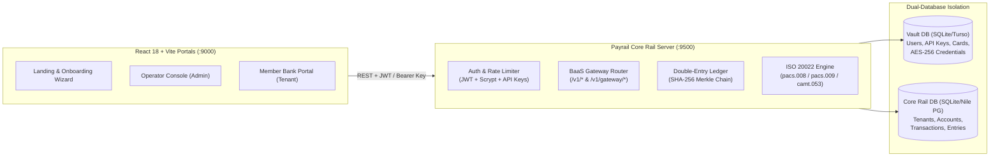

# ⚡ Payrail — Sovereign B2B Clearinghouse & BaaS Gateway

Payrail is an institutional-grade **B2B Payment Rail, Double-Entry Clearinghouse, and Banking-as-a-Service (BaaS) Gateway**. It enables central clearinghouse operators and member financial institutions to onboard isolated shards, execute cryptographically signed interbank transfers (`ISO 20022 pacs.008`), run multilateral Deferred Net Settlement sweeps (`ISO 20022 pacs.009`), export `ISO 20022 camt.053` XML statements, and consume 9 unified BaaS APIs.

---

## 🏗️ System Architecture



### Dual-Database Design
1. **Vault Database (`vaultDb`)**: Dedicated security store for operator/member user accounts (`scrypt` password hashes), API secret keys (`SHA-256`), `AES-256-GCM` encrypted virtual card PAN/CVVs, password recovery tokens, and webhook HMAC secrets.
2. **Core Rail Database (`railDb`)**: Multi-tenant financial ledger supporting both local SQLite/LibSQL (`rail.db`) and distributed Nile Postgres (`NILE_DATABASE_URL`) with tenant shard isolation (`tenant_id`), immutable double-entry journal postings, and cryptographic SHA-256 Merkle hash chaining.

---

## 🔌 Integrated BaaS Services (9 Core Engines)

| Service ID | Capability | Primary Engine / Fallback |
| :--- | :--- | :--- |
| `payment_intents` | Priority Waterfall Payment Routing & Failover | Payrail Multi-Rail Waterfall Router |
| `settlement_clearing` | Interbank Clearing & ISO 20022 (`pacs.008`, `pacs.009`, `camt.053`) | Payrail Double-Entry Clearinghouse |
| `fx_conversion` | Live Foreign Exchange Rates & Currency Conversion | Fixer.io Live API + Institutional Reference Desk |
| `aml_screening` | OFAC SDN Sanctions & PEP Fuzzy-Match Screening | US Treasury OFAC SDN Live XML + ComplyAdvantage |
| `card_issuance` | Luhn-Valid Virtual Card Issuing, AES-256 Vault & Spend Auth | Payrail Internal Card Network + Marqeta |
| `ach_wire` | NACHA ACH Debit/Credit, Fedwire & SWIFT Transfers | Payrail NACHA / ISO 20022 Clearing Engine |
| `credit_bureau` | Soft Credit Pull & Deterministic Ledger Underwriting | Payrail Ledger-Backed Credit Bureau + Equifax |
| `otp_verification` | 6-Digit Transactional Email OTP Delivery | SendGrid API + In-Network OTP Engine |
| `crypto_wallets` | Web3 EVM RPC Block Status & ERC-20 Token Payouts | Ethers.js v6 JSON-RPC Adapter |

---

## 🚀 Quickstart

### 1. Install Dependencies
```bash
npm install
cd server && npm install
cd ../frontend && npm install
```

### 2. Configure Environment
Copy [`server/.env.example`](file:///D:/Finance/payment%20rail/server/.env.example) to `server/.env` (optional for local development — all 9 services include zero-config local/institutional engines out of the box).

### 3. Start the Platform
From the root directory (`D:\Finance\payment rail`):
```bash
npm run dev
```
- **Frontend Portal**: `http://127.0.0.90:9000`
- **Backend Core API**: `http://127.0.0.95:9500`

### 4. Default Credentials
- **Clearinghouse Operator Login**:
  - **Username**: `admin`
  - **Password**: `admin123` (or `ADMIN_DEFAULT_PASSWORD` from `.env`)
- **Default Platform Gateway API Key**:
  - `sk_live_dev_key_12345`

---

## 🧪 Verification & Test Suites

Run the automated verification suites from the project root:

```bash
# 1. Verify Double-Entry Ledger & Priority Failover Swap Engine
npm run test:gateway

# 2. End-to-End Live HTTP Gateway & Priority Failover Test
npm run test:live

# 3. End-to-End B2B Onboarding, Secp256k1 ECDSA PACS.008 Signing & PACS.009 DNS Sweep
npm run test:b2b

# 4. Reset Dual-Database to Clean Slate
npm run db:clear
```

---

## 📚 Documentation Index
- [Security & Cryptography Architecture (`SECURITY.md`)](file:///D:/Finance/payment%20rail/SECURITY.md)
- [Complete REST API Reference (`API_REFERENCE.md`)](file:///D:/Finance/payment%20rail/API_REFERENCE.md)
- [Environment Configuration Template (`server/.env.example`)](file:///D:/Finance/payment%20rail/server/.env.example)
